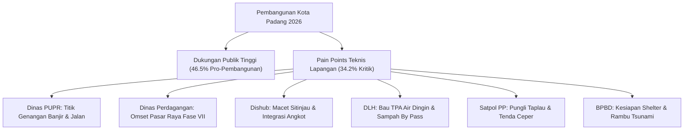

# MATRIKS REKOMENDASI KEBIJAKAN & INTERVENSI TAKTIS OPD
# PEMERINTAH KOTA PADANG TAHUN 2026

**Dokumen Rujukan:** Hasil Pemetaan Sentimen & Persepsi Publik (5 September – 5 November 2026)  
**Tujuan Dokumen:** *Policy Brief* Tindak Lanjut untuk Wali Kota, Sekretaris Daerah, Bappeda, dan Kepala OPD Teknis  

---

## 1. RINGKASAN EKSEKUTIF UNTUK PIMPINAN DAERAH

Hasil analisis terhadap 260 rekaman percakapan dan pemberitaan media massa menunjukkan bahwa **arah pembangunan Kota Padang tahun 2026 pada dasarnya didukung oleh mayoritas masyarakat (tingkat penolakan murni hanya 5.8%)**. 

Namun, terdapat **kesenjangan operasional (operational gap)** yang memicu tingginya sentimen negatif (34.2%) dan kelompok warga yang bersikap **Meminta Perbaikan (26.5%)**. Ketidakpuasan publik bukan disebabkan oleh penolakan terhadap visi kota, melainkan akibat **kelemahan koordinasi teknis, lambatnya mitigasi dampak konstruksi, dan lemahnya komunikasi publik di lapangan**.



---

## 2. MATRIKS INTERVENSI KEBIJAKAN PER-DINAS TEKNIS (OPD)

---

### A. DINAS PEKERJAAN UMUM DAN PENATAAN RUANG (PUPR)
*Fokus Isu: Drainase Perkotaan, Penanganan Banjir Genangan, dan Jalan Lingkungan*

| Komponen | Uraian Masalah & Rencana Aksi Kebijakan |
| :--- | :--- |
| **Masalah Riil Warga** | 1. Genangan air berulang di Dadok Tunggul Hitam, Jondul Rawang, Koto Tangah, dan Maransi pascahujan.<br>2. Saluran drainase sekunder tersumbat sedimentasi pasir dan tumpukan sampah plastik.<br>3. Bekas galian pipa/gorong-gorong di jalan protokol yang lama ditutup kembali, memicu debu dan kecelakaan. |
| **Bukti Data Terindeks** | • [Kompas.com: Banjir Koto Tangah Padang Paling Parah](https://regional.kompas.com/read/2026/08/04/202304478/30-tahun-tinggal-di-koto-tangah-padang-warga-sebut-banjir-kali-ini-paling?page=all)<br>• [Antara News: Warga Padang Utara Keluhkan Drainase Tersumbat](https://sumbar.antaranews.com/berita/179744/warga-padang-utara-keluhkan-drainase-tersumbat)<br>• [Padang TV: Banjir Bandang Rusak Jaringan Irigasi](https://www.youtube.com/watch?v=tIRKCuw8jmY) |
| **Aksi Cepat (30 Hari)** | 1. **Pengerahan Satgas Drainase Reaksi Cepat:** Kerahkan armada penyedot lumpur ke 5 titik merah genangan sebelum puncak musim penghujan akhir tahun.<br>2. **Standar Operasional Penutupan Galian:** Wajibkan seluruh kontraktor galian meratakan dan mengaspal kembali jalan maksimal 3x24 jam pascapemasangan pipa. |
| **Program Taktis (3–6 Bulan)** | 1. **Normalisasi Saluran Sekunder Terpadu:** Melanjutkan pengerukan hulu sungai Batang Arau dan Batang Kuranji hingga saluran tersier permukiman.<br>2. **Pemasangan Saringan Sampah Otomatis (Trash Barrier):** Tempatkan jaring penahan sampah di muara sungai perbatasan Koto Tangah dan Padang Selatan. |
| **Target KPI OPD** | Penurunan durasi genangan air dari rata-rata 4 jam menjadi <60 menit pascahujan reda. |

---

### B. DINAS PERHUBUNGAN (DISHUB) KOTA PADANG
*Fokus Isu: Angkutan Massal Trans Padang, Harmonisasi Angkot, dan Pengaturan Jalur Strategis*

| Komponen | Uraian Masalah & Rencana Aksi Kebijakan |
| :--- | :--- |
| **Masalah Riil Warga** | 1. Waktu tunggu bus (*headway*) Trans Padang koridor 4 dan 5 mencapai 45–60 menit pada jam sibuk kerja/sekolah.<br>2. Penolakan dan demo berkala dari sopir angkot konvensional yang kehilangan trayek akibat tumpang tindih koridor.<br>3. Kemacetan parah sistem buka-tutup tanjakan Sitinjau Lauik jalur Padang–Solok akibat minimnya pengaturan rekayasa lalu lintas. |
| **Bukti Data Terindeks** | • [Padang TV: Macet Panjang Buka-Tutup Jalur Sitinjau Lauik](https://www.youtube.com/watch?v=2SU5acelWtE)<br>• [Liputan 6: Demo Sopir Angkot Tuntut Revisi Perwako Trans Padang](https://www.youtube.com/watch?v=TIVXQYAwNms)<br>• [Antara News: Pengemudi Angkot Padang Demo ke Balai Kota](https://bengkulu.antaranews.com/berita/92621/cari-uang-rp30-ribu-saja-kian-sulit-pengemudi-angkot-di-padang-demo-ke-balai-kota) |
| **Aksi Cepat (30 Hari)** | 1. **Live Report Situasi Sitinjau Lauik:** Luncurkan siaran informasi situasi lalu lintas Sitinjau Lauik setiap 2 jam via akun resmi Dishub dan CCTV online agar sopir logistik dapat mengatur waktu berangkat.<br>2. **Penambahan Armada Jam Sibuk:** Alihkan 4 armada cadangan ke Koridor 4 (Pauh/Unand) pada pukul 06.30–08.30 dan 16.30–18.30 WIB. |
| **Program Taktis (3–6 Bulan)** | 1. **Program Konversi Angkot Menjadi Feeder (Rupiah per Km):** Bentuk konsorsium angkot lokal sebagai pengumpan resmi Trans Padang rute perumahan pinggiran dengan sistem subsidi pendapatan pasti.<br>2. **Revisi Zonasi Titik Halte:** Geser plang halte yang berhimpitan langsung dengan pangkalan pangkalan angkot konvensional untuk meredam konflik horisontal. |
| **Target KPI OPD** | *Headway* Trans Padang stabil di kisaran 15 menit; nihil aksi mogok massal sopir angkot. |

---

### C. DINAS PERDAGANGAN KOTA PADANG
*Fokus Isu: Revitalisasi Pasar Raya Fase VII dan Penataan Pedagang*

| Komponen | Uraian Masalah & Rencana Aksi Kebijakan |
| :--- | :--- |
| **Masalah Riil Warga** | 1. Gedung baru Pasar Raya Fase VII lantai 2 dikeluhkan sangat sepi pembeli; pedagang mengalami penurunan omset hingga 60%.<br>2. Pembeli enggan naik ke lantai atas akibat tangga yang melelahkan dan eskalator/lift barang yang sering tidak beroperasi.<br>3. Kekecewaan terkait transparansi undian (*loting*) kios dan aduan PKL lama yang lapaknya tergeser. |
| **Bukti Data Terindeks** | • [Padang Ekspres: Pedagang Keluhkan Pasar Raya Fase VII Sepi](https://padek.jawapos.com/padang/2501070002/pedagang-keluhkan-pasar-raya-fase-vii-sepi)<br>• [Langgam.id: Penurunan Omset Pedagang Sejak Pindah ke Fase VII](https://langgam.id/pedagang-keluhkan-penurunan-omset-sejak-pindah-ke-fase-vii-pasar-raya-padang/) |
| **Aksi Cepat (30 Hari)** | 1. **Aktivasi Wajib Eskalator & Lift Barang:** Pastikan fasilitas penggerak vertikal menyala penuh sejak pukul 07.00 hingga 18.00 WIB setiap hari.<br>2. **Pemasangan Signage & Penunjuk Arah Tematik:** Pasang papan nama kategori dagangan yang besar di lobi pintu masuk utama lantai dasar yang mengarahkan pembeli ke lantai 2. |
| **Program Taktis (3–6 Bulan)** | 1. **Zonasi Magnet Pengunjung di Lantai 2:** Pindahkan kantor layanan publik perizinan/perbankan atau sentra kuliner viral Padang ke lantai atas sebagai *traffic generator*.<br>2. **Festival & Pasar Murah Berkala di Lantai 2:** Selenggarakan program belanja berhadiah dan bazar UMKM bulanan untuk meramaikan lantai atas. |
| **Target KPI OPD** | Peningkatan arus kunjungan pembeli ke lantai 2 sebesar 40%; pemulihan omset pedagang minimum 75% dari masa sebelum relokasi. |

---

### D. DINAS LINGKUNGAN HIDUP (DLH) KOTA PADANG
*Fokus Isu: Polusi Bau TPA Air Dingin, TPS Liar By Pass, dan Ketertiban Sampah*

| Komponen | Uraian Masalah & Rencana Aksi Kebijakan |
| :--- | :--- |
| **Masalah Riil Warga** | 1. Bau busuk menyengat dan lonjakan populasi lalat dari gunungan sampah TPA Air Dingin mengganggu kesehatan warga Kelurahan Balai Gadang, Koto Tangah.<br>2. Tumpukan sampah liar di sepanjang jalan By Pass (Pisang–Ketaping) yang merusak estetika gerbang kota.<br>3. Warga merasa aturan denda sampah tidak adil karena tempat sampah resmi di lingkungan permukiman sangat minim. |
| **Bukti Data Terindeks** | • [Langgam.id: TPA Air Dingin Penuh Sesak Sampah 640 Ton per Hari](https://langgam.id/tpa-air-dingin-penuh-sesak-sampah-warga-padang-capai-640-ton-sehari/)<br>• [Padangkita: DLH Pasang Terpal Truk Sampah Tanggapi Keluhan](https://padangkita.com/tanggapi-keluhan-masyarakat-dlh-padang-pasang-terpal-di-truk-sampah/) |
| **Aksi Cepat (30 Hari)** | 1. **Pemberian Disinfektan & Penutup Tanah Rutin TPA:** Lakukan penyemprotan enzim anti-bau dan penutupan lapisan tanah berkala pada zona aktif TPA Air Dingin.<br>2. **Penempatan Kontainer Resmi di Titik TPS Liar:** Letakkan bak kontainer tertutup di 6 titik tumpukan liar sepanjang By Pass sebelum menerapkan sanksi denda. |
| **Program Taktis (3–6 Bulan)** | 1. **Percepatan Proyek TPST RDF:** Operasikan fasilitas pengolahan sampah menjadi bahan bakar alternatif (*Refuse Derived Fuel*) bekerja sama dengan PT Semen Padang guna mengurangi pasokan sampah ke TPA.<br>2. **Jadwal Pasti Truk Sampah Lingkungan:** Terbitkan kalender jadwal ritasi truk sampah per kelurahan berbasis aplikasi/WhatsApp grup warga. |
| **Target KPI OPD** | Reduksi keluhan bau TPA sebesar 50%; sterilisasi 100% TPS liar di sepanjang jalur arteri By Pass. |

---

### E. SATUAN POLISI PAMONG PRAJA (SATPOL PP) KOTA PADANG
*Fokus Isu: Penertiban Kawasan Pantai Padang, Pungli Parkir, dan Penegakan Humanis*

| Komponen | Uraian Masalah & Rencana Aksi Kebijakan |
| :--- | :--- |
| **Masalah Riil Warga** | 1. Praktik tenda/payung ceper di Pantai Padang yang disalahgunakan untuk perbuatan asusila, meresahkan keluarga dan wisatawan.<br>2. Gesekan fisik dan adu mulut antara petugas penertiban dengan pedagang kaki lima saat pembongkaran lapak.<br>3. Pungutan liar (pungli) tarif parkir tidak resmi (Rp10.000–Rp15.000) di kawasan Taplau dan Muaro Lasak. |
| **Bukti Data Terindeks** | • [Liputan 6: Pembongkaran Tenda Ceper Pantai Padang](https://www.youtube.com/watch?v=MYIudSSZWKc)<br>• [Liputan 6: Penertiban PKL Pantai Padang Diwarnai Adu Mulut](https://www.youtube.com/watch?v=ut7baNTy1a4)<br>• [Padang Ekspres: Wakil Ketua DPRD Soroti Maraknya Pungli Pantai Padang](https://padek.jawapos.com/padang/2510140020/wakil-ketua-dprd-padang-soroti-maraknya-pungli-di-pantai-padang-minta-pemko-bertindak-tegas) |
| **Aksi Cepat (30 Hari)** | 1. **Posko Pengawasan Anti-Pungli Bersama TNI/Polri:** Tempatkan pos terpadu di 3 titik strategis (Taplau, Muaro Lasak, Jembatan Siti Nurbaya) dilengkapi papan tarif parkir resmi berukuran besar.<br>2. **Pemberlakuan Aturan Jam Operasional Lapak Humanis:** Larang pemasangan tenda tertutup pasca-pukul 18.00 WIB tanpa merusak dagangan pedagang. |
| **Program Taktis (3–6 Bulan)** | 1. **Pendekatan Kultural Adat Ninik Mamak:** Libatkan KAN (Kerapatan Adat Nagari) Padang Barat dalam penyusunan aturan kesepakatan relokasi PKL pantai.<br>2. **Legalitas Rompi & Identitas Juru Parkir Resmi:** Terbitkan tanda pengenal ber-QRIS untuk seluruh juru parkir di bawah binaan Dishub dan Satpol PP. |
| **Target KPI OPD** | Zero kasus pungutan liar viral; tidak ada insiden kekerasan fisik dalam penegakan ketertiban umum. |

---

### F. BADAN PENANGGULANGAN BENCANA DAERAH (BPBD)
*Fokus Isu: Kesiapsiagaan Bencana Megathrust, Shelter Tsunami, dan Jalur Evakuasi*

| Komponen | Uraian Masalah & Rencana Aksi Kebijakan |
| :--- | :--- |
| **Masalah Riil Warga** | 1. Gedung Tempat Evakuasi Sementara (TES/Shelter) di Ulak Karang dan Pasie Nan Tigo ditemukan dalam kondisi digembok dan tidak terawat.<br>2. Plang rambu jalur evakuasi di kawasan permukiman pesisir banyak yang tertutup dahan kayu atau pudar catnya.<br>3. Keresahan warga akan gempa malam hari di zona merah pesisir. |
| **Bukti Data Terindeks** | • [Laporan Aspirasi Warga Padang Utara terkait Kesiapan Shelter TES]<br>• [Simulasi Bencana Mandiri Megathrust BPBD Padang] |
| **Aksi Cepat (30 Hari)** | 1. **Buka Gembok Seluruh Gedung Shelter Tsunami:** Ganti sistem kunci gembok dengan sistem pintu darurat akses cepat (*panic exit device*) dan serahkan kunci duplikat ke pengurus RT/RW serta Babinsa terdekat.<br>2. **Pembersihan Sarana Sanitasi & Lampu Shelter:** Perbaiki instalasi air dan pasang lampu darurat bertenaga surya di gedung TES. |
| **Program Taktis (3–6 Bulan)** | 1. **Peremajaan Rambu Fosfor Menyala Malam:** Ganti plang evakuasi sepanjang 20 km pesisir dengan material reflektif fosfor (*glow in the dark*).<br>2. **Simulasi Evakuasi Khusus Lansia & Difabel:** Gelar latihan rutin evakuasi berbasis keluarga rentan di kelurahan zona merah pantai. |
| **Target KPI OPD** | 100% gedung shelter siap pakai 24 jam; waktu evakuasi mandiri warga menuju shelter rata-rata <15 menit. |

---

### G. DINAS KOMINFO & BAGIAN PROTOKOL PIMPINAN (PROKOPIM)
*Fokus Isu: Manajemen Krisis Komunikasi dan Kanal Respons Cepat Warga*

| Komponen | Uraian Masalah & Rencana Aksi Kebijakan |
| :--- | :--- |
| **Masalah Riil Warga** | 1. Komplain warga di media sosial lambat direspons secara resmi, sehingga isu negatif terlanjur viral secara liar.<br>2. Publik merasa laporan di media sosial tidak terkoneksi langsung dengan aksi dinas teknis di lapangan. |
| **Aksi Cepat (30 Hari)** | 1. **Bentuk Tim Cyber Response & Klarifikasi 24 Jam:** Tugaskan tim admin medsos Pemko untuk memberikan respons awal pada keluhan viral maksimal dalam 60 menit dengan format: *"Laporan diterima, sedang dikoordinasikan ke Dinas [Terkait]"*.<br>2. **Publikasi Konten Tindak Lanjut (Before-After):** Wajibkan setiap OPD mendokumentasikan foto/video hasil perbaikan (misal: selokan yang sudah dikeruk, lampu jalan yang sudah menyala). |
| **Program Taktis (3–6 Bulan)** | 1. **Integrasi Medsos ke SP4N-LAPOR! Padang:** Bangun sistem otomasi pengaduan medsos langsung terkonversi menjadi tiket kerja dinas teknis.<br>2. **Dashboard Sentimen Publik Mingguan untuk Wali Kota:** Gunakan model klasifikasi teks otomatis berbasis Machine Learning ini sebagai radar mingguan pemantauan kepuasan warga. |
| **Target KPI OPD** | *Response rate* aduan medsos mencapai 90% dalam waktu <2 jam. |

---

## 3. TIMELINE IMPLEMENTASI REKOMENDASI KEBIJAKAN

```
BULAN 1 (Konsolidasi & Quick Wins):
├── Satgas Anti-Pungli Pantai Padang dibentuk (Satpol PP + Dishub)
├── Buka gembok & bersihkan seluruh gedung Shelter Tsunami (BPBD)
├── Pengerahan armada sedot lumpur di 5 titik banjir utama (PUPR)
├── Aktivasi eskalator & petunjuk arah lantai 2 Fase VII (Dinas Perdagangan)
└── Standarisasi live report jalur Sitinjau Lauik (Dishub)

BULAN 2–3 (Intervensi Taktis & Regulasi):
├── Konsolidasi konversi angkot feeder Trans Padang (Dishub)
├── Pemasangan bak kontainer di titik TPS liar By Pass (DLH)
├── Peremajaan rambu evakuasi fosfor pesisir (BPBD)
└── Sinergi KAN / Ninik Mamak untuk tata kelola PKL pantai (Satpol PP)

BULAN 4–6 (Optimalisasi Berkelanjutan):
├── Percepatan TPST-RDF TPA Air Dingin (DLH)
├── Integrasi tiket digital medsos ke SP4N-LAPOR (Diskominfo)
└── Evaluasi dampak pemulihan omset pedagang Fase VII (Dinas Perdagangan)
```
